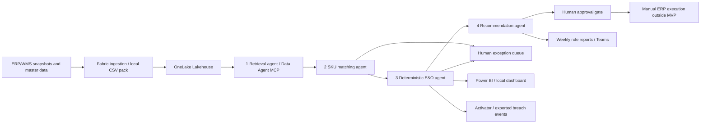

# Architecture and boundaries

Every stage emits a validated hand-off. Inputs, cutoff and policy form a reproducible run identity; source references bind evidence to input file hashes. Failed rows are quarantined. An invalid master or malformed baseline fails the run rather than silently creating partial truth. A cutoff mismatch produces an explicitly non-comparable reconciliation, not a fabricated zero variance.

The local engine directly coordinates four deterministic roles. The supplied Fabric notebook executes the same business engine and materializes results in Delta tables. The Microsoft Agent Framework graph invokes four Azure model agents, each with its own bounded deterministic stage tool, without delegating financial arithmetic or approval to an LLM. Local role IDs are not Entra identities.

Distinct warehouses may aggregate into one canonical SKU. All accepted holdings for that SKU must agree on global demand, safety stock and unit cost. Stock from separate source systems must be pre-scoped to unique physical holdings before ingestion; a cross-system mirrored holding cannot be inferred safely from a CSV without a shared physical holding ID.

Approval is a transactional state transition at `(run_id, canonical_sku)` and chooses one recommendation. Rejection closes that SKU's proposal set for the run; corrections require a new run/new source or policy version. This prevents retries, alternate options and simultaneous reviewers from double counting recovery. Execution and realized cash are intentionally outside the MVP.

## Future improvements: SKU detection and reconciliation

These are proposed investigation steps for a future iteration, with no implementation or delivery commitment in the current MVP. Evaluate regular expressions and conditional random fields (CRF, условно-случайные поля) as complementary options for extracting product identifiers and attributes before canonical SKU matching.

1. **Establish an evaluation baseline.** Collect representative supplier descriptions and documents, label SKU/MPN spans and relevant attributes (brand, model, dimensions, pack size and unit), and record the correct canonical SKU or an explicit unmatched outcome. Separate training, development and held-out evaluation data by supplier or document template to check generalization.
2. **Evaluate regular expressions first.** Explore versioned supplier-specific and shared patterns for known SKU/MPN formats, explicit identifier labels, dimensions and pack/unit expressions. Preserve the original text and source location; treat extracted identifiers as candidates that still require master-data validation. Include negative cases such as dates, prices and quantities that resemble identifiers.
3. **Evaluate CRF sequence labelling.** If the regex baseline leaves meaningful gaps, investigate a CRF trained on labelled token sequences to identify SKU/MPN spans and surrounding attributes. Candidate features include token shape, letter/digit patterns, separators, neighbouring words and regex matches. Assess whether the additional labelling and maintenance effort is justified by improvements on unseen supplier formats.
4. **Compare a combined approach.** Test regex alone, CRF alone and regex features combined with CRF against the existing extraction and matching baseline. Keep extraction separate from identity resolution: use validated identifiers and attributes to propose canonical matches, preserve numeric/MPN compatibility checks, and send ambiguous or conflicting candidates to human review.
5. **Decide on adoption using held-out evidence.** Measure identifier extraction precision/recall, canonical-match precision/recall, false matches, abstention/review rate, latency and operating cost. Report results by supplier and format; agree acceptance thresholds before final evaluation. Advance only if improvements justify the complexity without weakening matching safeguards.
