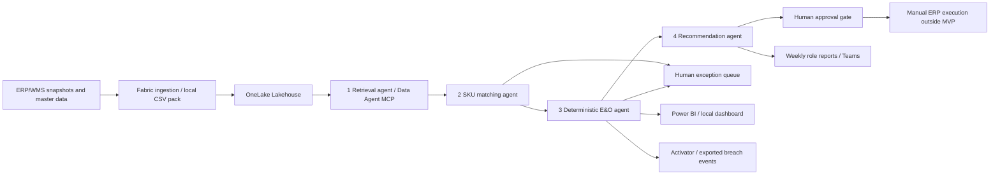

# Architecture and boundaries

Every stage emits a validated hand-off. Inputs, cutoff and policy form a reproducible run identity; source references bind evidence to input file hashes. Failed rows are quarantined. An invalid master or malformed baseline fails the run rather than silently creating partial truth. A cutoff mismatch produces an explicitly non-comparable reconciliation, not a fabricated zero variance.

The local engine directly coordinates four deterministic roles. The supplied Fabric notebook executes the same business engine and materializes results in Delta tables. The Microsoft Agent Framework graph invokes four Azure model agents, each with its own bounded deterministic stage tool, without delegating financial arithmetic or approval to an LLM. Local role IDs are not Entra identities.

Distinct warehouses may aggregate into one canonical SKU. All accepted holdings for that SKU must agree on global demand, safety stock and unit cost. Stock from separate source systems must be pre-scoped to unique physical holdings before ingestion; a cross-system mirrored holding cannot be inferred safely from a CSV without a shared physical holding ID.

Approval is a transactional state transition at `(run_id, canonical_sku)` and chooses one recommendation. Rejection closes that SKU's proposal set for the run; corrections require a new run/new source or policy version. This prevents retries, alternate options and simultaneous reviewers from double counting recovery. Execution and realized cash are intentionally outside the MVP.
